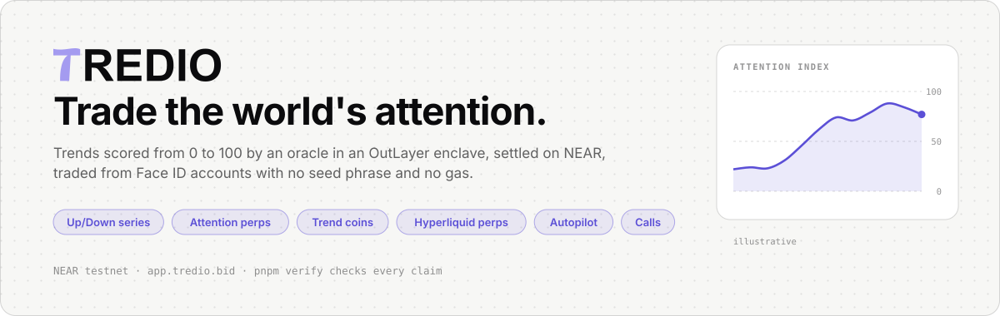
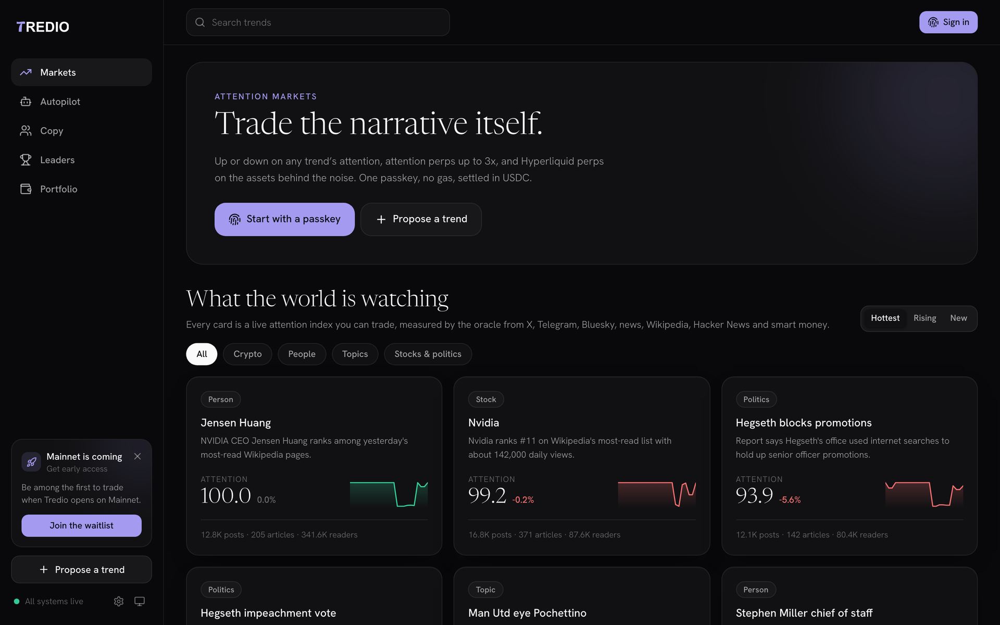
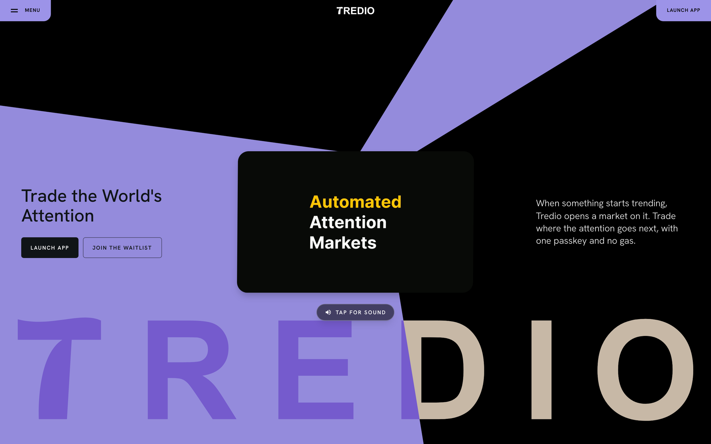
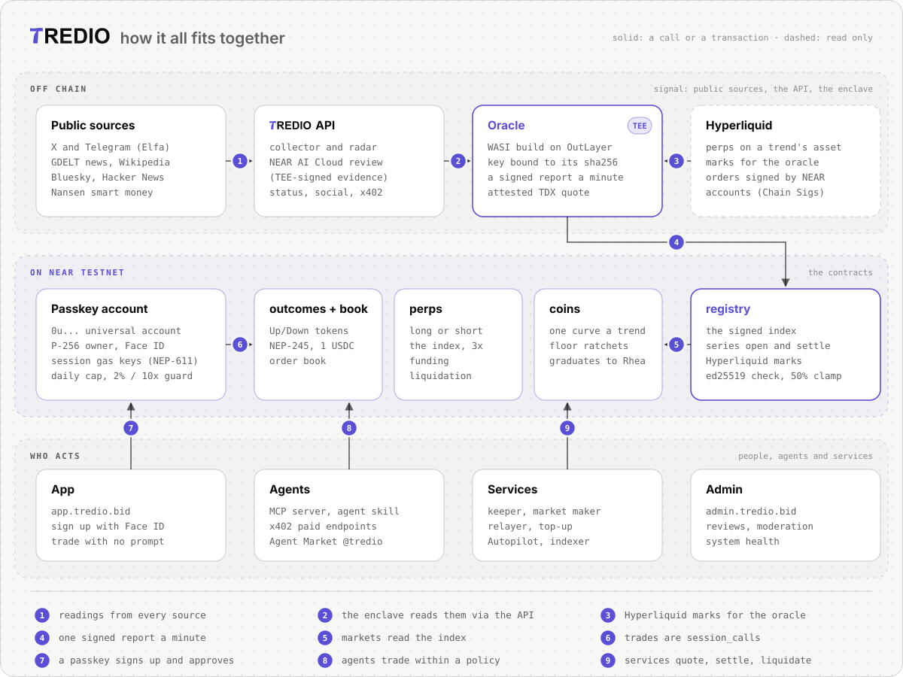
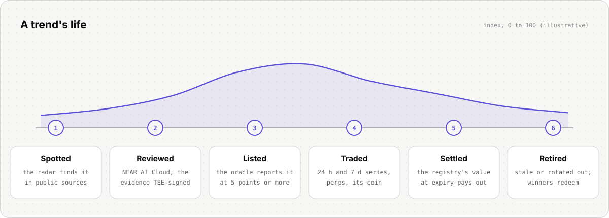
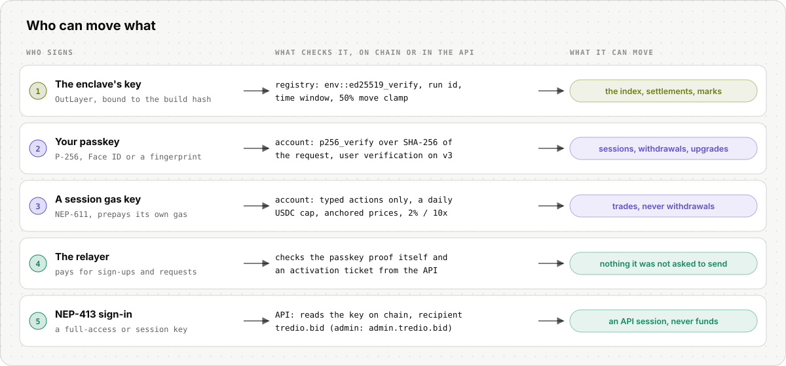

<p align="center">
  <picture>
    <source media="(prefers-color-scheme: dark)" srcset="assets/readme/hero-dark.svg">
    <source media="(prefers-color-scheme: light)" srcset="assets/readme/hero-light.svg">
    
  </picture>
</p>

<p align="center">
  <a href="https://app.tredio.bid"></a>
  <a href="deployments/testnet.json"></a>
  <a href="apps/oracle/docs/tee.md"></a>
  <a href="https://testnet.nearblocks.io/address/registry.tredio.testnet/contract/code"></a>
  <a href="https://tredio.market.near.ai"></a>
  <br>
  <a href="https://github.com/EmadQureshiKhi/Tredio/actions/workflows/ci.yml"></a>
  
  
  <a href="LICENSE"></a>
</p>

<p align="center">
  <a href="https://app.tredio.bid"><b>Open the app</b></a>
  &nbsp;·&nbsp;
  <a href="https://tredio.bid"><b>Website</b></a>
  &nbsp;·&nbsp;
  <a href="https://api.tredio.bid/v1/status"><b>API status</b></a>
  &nbsp;·&nbsp;
  <a href="JUDGES.md"><b>Judges' guide</b></a>
  &nbsp;·&nbsp;
  <a href="AGENTS.md"><b>For AI agents</b></a>
  &nbsp;·&nbsp;
  <a href="https://tredio.bid/llms.txt"><b>llms.txt</b></a>
</p>

<br>

**Tredio turns what the internet is talking about into markets you can trade.**

An AI radar finds trends, and NEAR AI Cloud reviews each one with verifiable models.
An oracle in an OutLayer enclave scores every trend from 0 to 100, and that score lives on NEAR, where people trade it.
You sign up with Face ID, get a NEAR account with no seed phrase, and trade for a week without another prompt or a drop of gas.

<br>

## At a glance

| | Tredio |
| --- | --- |
| **What it is** | An attention market: Up/Down series, perps and coins on a trend's attention index, plus Hyperliquid perps signed by your NEAR account |
| **Where it runs** | Everything on NEAR testnet: 8 contracts, the enclave oracle, passkey accounts and every service; the code is ready for mainnet ([MAINNET.md](MAINNET.md)) |
| **Try it** | [app.tredio.bid](https://app.tredio.bid): sign up with a passkey and trade; the [status page](https://app.tredio.bid/status) shows every service live |
| **Check it** | `pnpm verify` reads testnet and checks every claim in [JUDGES.md](JUDGES.md), then runs every test suite |
| **NEAR pieces** | NEP-655 universal accounts, `p256_verify`, NEP-611 gas keys, global contracts, Chain Signatures, NEAR Intents 1Click, NEAR AI Cloud, OutLayer TEE, x402 on NEAR, NEP-366 delegate actions |
| **Security** | Self-audit (11 findings, 10 fixed, 1 bounded by design), Rustle, Clippy security lints, `cargo deny`, and all 8 contracts source-verified on NearBlocks |

> [!NOTE]
> The app, website and API are live at tredio.bid.
> Everything also runs locally against testnet (see [Run it](#run-it)), and every on-chain claim can be checked with `pnpm verify`.

<br>

<p align="center">
  
</p>

<details>
<summary><b>Contents</b></summary>

<br>

- [What you can trade](#what-you-can-trade)
- [Screens](#screens)
- [Only on NEAR](#only-on-near)
- [How it works](#how-it-works)
- [Who can move what](#who-can-move-what)
- [Contracts on testnet](#contracts-on-testnet)
- [Ready for mainnet](#ready-for-mainnet)
- [Check it yourself](#check-it-yourself)
- [Security](#security)
- [Run it](#run-it)
- [Repository](#repository)
- [For AI agents](#for-ai-agents)
- [Built with](#built-with)

</details>

<br>

## What you can trade

| Market | What it is |
| --- | --- |
| **Up/Down series** | Will a trend's attention close above its opening level in 24 hours or 7 days? Each token pays 1 USDC if it is right, on an on-chain order book. |
| **Attention perps** | Go long or short on the index itself, with isolated margin up to 3x and funding from the skew between longs and shorts. |
| **Trend coins** | One token per trend on a bonding curve whose floor ratchets up with peak attention, graduating into a Rhea pool. |
| **Hyperliquid perps** | On the asset behind a trend, signed by your NEAR account. |
| **Autopilot and copy-trading** | Rules with stop-loss, take-profit and loss limits, or follow a top Hyperliquid trader, executed through a session you can revoke. |
| **Calls** | Post a public call from an unlinkable caller identity and build a hit rate on the leaderboard. |

<br>

## Screens

<table>
  <tr>
    <td width="50%"></td>
    <td width="50%"></td>
  </tr>
  <tr>
    <td align="center"><sub><b>A trend</b>: its index, its stats and the trade ticket</sub></td>
    <td align="center"><sub><b>Status</b>: the oracle, the NEAR head and every service</sub></td>
  </tr>
</table>

<br>

<p align="center">
  
  <br>
  <sub><b>The website</b> at <a href="https://tredio.bid">tredio.bid</a></sub>
</p>

<br>

## Only on NEAR

Each of these is a NEAR primitive doing real work in the product, not a logo on a slide.

| # | What | NEAR pieces |
| :-: | --- | --- |
| 1 | [Face ID accounts with no seed phrase and no gas](#1-face-id-accounts-with-no-seed-phrase-and-no-gas) | NEP-655 universal accounts, `p256_verify`, NEP-611 gas keys, global contracts |
| 2 | [An oracle in an enclave](#2-an-oracle-in-an-enclave) | OutLayer TEE, `env::ed25519_verify` |
| 3 | [AI review you can verify](#3-ai-review-you-can-verify) | NEAR AI Cloud, TEE-signed evidence |
| 4 | [Hyperliquid perps from a NEAR account](#4-hyperliquid-perps-from-a-near-account) | Chain Signatures |
| 5 | [Deposits from any chain](#5-deposits-from-any-chain) | NEAR Intents 1Click |
| 6 | [A service fleet on gas keys](#6-a-service-fleet-on-gas-keys) | NEP-611 gas keys with nonce lanes |
| 7 | [Autopilot on a revocable on-chain grant](#7-autopilot-on-a-revocable-on-chain-grant-optionally-signed-in-a-tee) | sessions, OutLayer custody wallets |
| 8 | [Paid data for agents](#8-paid-data-for-agents-settled-in-usdc-on-near) | x402 on NEAR, NEP-366 delegate actions |
| 9 | [Paid private signals](#9-paid-private-signals-committed-on-chain-first) | NEP-141 memo commitments |

<br>

### 1. Face ID accounts with no seed phrase and no gas

A passkey creates a NEP-655 universal account (`0u...`) whose id is derived from the passkey itself, from inside the `accounts` factory, on a global contract.

The account checks the passkey's P-256 signature on chain with the `p256_verify` host function, so no server can act as the owner.

One prompt adds a week-long session key that is a NEP-611 gas key: it prepays its own gas and can only send typed trades, under a daily USDC cap for everything that moves USDC on NEAR.
Hyperliquid actions move no USDC on NEAR, so the price band and leverage limit in [4](#4-hyperliquid-perps-from-a-near-account) bound those.

- **In the app:** Sign in, then trade.
- **Code:** [`contracts/account`](contracts/account), [`contracts/accounts`](contracts/accounts), [`frontend/src/lib/account`](frontend/src/lib/account)

<br>

### 2. An oracle in an enclave

The attention index is computed by a WASI build made for [OutLayer](https://outlayer.ai)'s TEE, pinned by its sha256.
OutLayer derives an ed25519 key bound to that exact build (`bind: wasm`).

The `registry` contract accepts a report only with the signature of the one oracle key it trusts (`env::ed25519_verify`), checks its run id and time window, and clamps every move.

- **Status on testnet:** Since 2026-11-10 the registry trusts only the enclave's key (one public `set_oracle` transaction), so every index value on chain was computed and signed in the enclave, once a minute, with an attested TDX quote per run. `pnpm verify` prints the key in use and checks a recorded run end to end.
- **In the app:** Every trend page shows its index history; the status page shows the oracle's last run.
- **Code:** [`apps/oracle/tee`](apps/oracle/tee), [`contracts/registry/src/oracle.rs`](contracts/registry/src/oracle.rs), method and trust model in [`apps/oracle/docs`](apps/oracle/docs)

<br>

### 3. AI review you can verify

Every candidate the radar finds is reviewed by NEAR AI Cloud's verifiable models.
An answer without a `provider_tee` signature is refused, and the hash of the signed evidence is written on the trend in the registry.

The API serves the exact request and response the signature covers.
Anyone can recompute both hashes and check the signature against the signing address in the evidence, without trusting Tredio.
That the address belongs to NEAR AI's TEE is checked against NEAR AI's own attestation at [cloud.near.ai/verify](https://cloud.near.ai/verify).

- **Status on testnet:** The radar's candidates are reviewed by NEAR AI Cloud, with evidence signed in the provider's TEE. `equity:tsla`, `topic:godzilla-minus-zero` and `person:stephen-miller` were listed from those reviews (live again as `.2` listings since the oracle outage of 2026-11-07, see JUDGES.md). Crypto candidates list only once smart-money inflow confirms them.
- **In the app:** The Verified chip on a reviewed trend opens the evidence.
- **Code:** [`backend/src/ai/nearai.ts`](backend/src/ai/nearai.ts), `GET /v1/reviews/:hash`

<br>

### 4. Hyperliquid perps from a NEAR account

Your account contract builds the Hyperliquid order (msgpack action, connection id, EIP-712 digest).
It then asks [Chain Signatures](https://docs.near.org/chain-abstraction/chain-signatures) (`v1.signer-prod.testnet`) to sign it with your account's own derived key.

A session can only sign orders within 2% of a fresh oracle mark and up to 10x leverage, enforced on chain.

- **Status on testnet:** Account code v3, whose guard binds the mark to the signed asset ([AUDIT.md](contracts/AUDIT.md), H-1) and which requires the passkey's user verification, is published. New accounts start on it, and older ones upgrade from Settings with one passkey prompt.
- **In the app:** The Perp tab's Hyperliquid market, on a trend with an asset. Today's live trends are mostly topics, and crypto trends (NEAR and Hyperliquid are queued) list once Nansen confirms smart-money inflow.
- **Code:** [`contracts/account/src/hyperliquid.rs`](contracts/account/src/hyperliquid.rs), [`packages/hyperliquid`](packages/hyperliquid)

<br>

### 5. Deposits from any chain

Deposits and withdrawals go through [NEAR Intents 1Click](https://docs.near-intents.org), so USDC on another chain lands in your NEAR account in one step.
1Click settles on mainnet only; on testnet the app shows real dry quotes.

- **In the app:** Deposit.
- **Code:** [`packages/intents`](packages/intents), [`backend/src/deposits`](backend/src/deposits)

<br>

### 6. A service fleet on gas keys

The relayer, keeper and market maker each send through a gas key with parallel nonce lanes, so one slow transaction never blocks the next.
The top-up service refills those keys and every service wallet from the treasury.

- **In the app:** The status page lists every wallet, key and lane.
- **Code:** [`packages/chain`](packages/chain), [`apps`](apps)

<br>

### 7. Autopilot on a revocable on-chain grant, optionally signed in a TEE

Turning on Autopilot adds a session labelled `autopilot` that can only trade Hyperliquid, under the same on-chain price and leverage guard, confirmed by reading the account.

The session's key can live in an OutLayer custody wallet instead of with the executor.
The account stores the wallet's policy as its controller (only the account itself as receiver, no NEAR attached, a call budget) and can freeze it with one passkey prompt.
Account code v3 lets the wallet act for the session as its own implicit account.

Stop-loss, take-profit and loss limits are enforced by the executor off chain.

- **Status on testnet:** An OutLayer enclave signed a `session_call` that a v3 account took as Autopilot's session and signed through Chain Signatures ([`ENCLocW8...`](https://testnet.nearblocks.io/txns/ENCLocW8Mk6KikN2nLgH56UQu8JoxFr2U56wPVn1ejKG)). The mainnet path through the NEAR Intents Agent API is tested offline.
- **In the app:** Autopilot (grant access, then "Policy wallet").
- **Code:** [`apps/autopilot`](apps/autopilot), [`backend/src/autopilot`](backend/src/autopilot), [`packages/custody`](packages/custody)

<br>

### 8. Paid data for agents, settled in USDC on NEAR

Premium API endpoints (full-resolution index history with every source reading, and Autopilot backtests) follow x402 v2's NEAR `exact` scheme:

1. The API answers HTTP 402.
2. The agent signs one USDC `ft_transfer` as a NEP-366 delegate action and sends it in `PAYMENT-SIGNATURE`.
3. Tredio's relayer submits it, so the agent needs no NEAR for gas.

An MCP server and an agent skill describe the whole product to AI agents.
The MCP server can also buy the paid history under a spending cap, and trade Up/Down, perps and coins and post calls for a user within the limits the user sets: an allowlist of tools, a USDC cap per call and a daily cap, from a passkey account's session key or the agent's own NEAR account.

- **Code:** [`backend/src/x402`](backend/src/x402), [`packages/chain/src/x402.ts`](packages/chain/src/x402.ts) (the paying client), [`packages/mcp`](packages/mcp), [`skills/tredio/SKILL.md`](skills/tredio/SKILL.md)

<br>

### 9. Paid private signals, committed on chain first

A leader publishes trade signals that stay sealed (AES-GCM under a weekly viewing key) until a delay the leader sets.
Followers buy early access in USDC on NEAR, paid straight to the leader's account.

Before the API takes a signal, its SHA-256 goes on chain in the memo of a 0.000001 USDC transfer from the leader's account, so nobody can change or backdate it.
Payments and commitments are read from the NEP-141 events the USDC contract logged.

Autopilot copies each signal within the follower's caps while access lasts, and agents buy the same viewing keys over x402, paid to the leader.
Positions on chain stay public; what is private is the signal and its timing, and Tredio's server, which sells the keys, can read every signal.

- **Status on testnet:** A channel, a committed signal ([`3PZMfvkS...`](https://testnet.nearblocks.io/txns/3PZMfvkSWy3ga6GW47ZXUBpASi24yRYg7sTbQ2NQsPf1)) and a follower's early-access payment ([`9swKsrx7...`](https://testnet.nearblocks.io/txns/9swKsrx7Z5xfR5HitX2BkcfhfX1DoMSLzFQA1ZhBk81g)), made by [`scripts/signals-demo.ts`](scripts/signals-demo.ts).
- **In the app:** Signals on a caller's profile, and Paid signals on Copy.
- **Code:** [`packages/autopilot/src/signals.ts`](packages/autopilot/src/signals.ts), [`backend/src/signals`](backend/src/signals), [`apps/autopilot/src/signals.ts`](apps/autopilot/src/signals.ts)

<br>

## How it works

<picture>
  <source media="(prefers-color-scheme: dark)" srcset="assets/readme/architecture-dark.svg">
  <source media="(prefers-color-scheme: light)" srcset="assets/readme/architecture-light.svg">
  
</picture>

<br>

1. **Spot.** The radar proposes trends from public sources, and NEAR AI Cloud reviews each one.
2. **Measure.** The oracle runs every minute. It reports a trend when its index moves 1%, or at least every seven minutes, and Hyperliquid marks on every run.
3. **Record.** The signed report updates the index and records each series' opening and settlement values and the marks; the keeper opens and settles series from them.
4. **Trade.** Markets read the registry: Up/Down series settle from it, perps use it as their price, and coins ratchet their floor from its peak.
5. **Act.** People trade from their own account contracts, and the services keep markets quoted, series settled and wallets funded.

<br>

<picture>
  <source media="(prefers-color-scheme: dark)" srcset="assets/readme/lifecycle-dark.svg">
  <source media="(prefers-color-scheme: light)" srcset="assets/readme/lifecycle-light.svg">
  
</picture>

<br>

## Who can move what

<picture>
  <source media="(prefers-color-scheme: dark)" srcset="assets/readme/trust-dark.svg">
  <source media="(prefers-color-scheme: light)" srcset="assets/readme/trust-light.svg">
  
</picture>

<br>

Every key in Tredio can move one kind of thing, and each check runs where nobody at Tredio can skip it:

- the registry checks the oracle's signature,
- your account contract checks your passkey and your sessions,
- and the API reads every sign-in key from the chain.

The details are in [AGENTS.md](AGENTS.md#how-the-pieces-trust-each-other) and [contracts/AUDIT.md](contracts/AUDIT.md).

<br>

## Contracts on testnet

| Contract | Account | What it does |
| --- | --- | --- |
| `registry` | [`registry.tredio.testnet`](https://testnet.nearblocks.io/address/registry.tredio.testnet) | Trends, the signed index, series opening and settlement values, Hyperliquid marks |
| `outcomes` | [`outcomes.tredio.testnet`](https://testnet.nearblocks.io/address/outcomes.tredio.testnet) | NEP-245 Up and Down tokens; a complete set mints and redeems for 1 USDC |
| `book` | [`book.tredio.testnet`](https://testnet.nearblocks.io/address/book.tredio.testnet) | Order book for Up and Down against USDC: limit, post-only and market orders |
| `perps` | [`perps.tredio.testnet`](https://testnet.nearblocks.io/address/perps.tredio.testnet) | Attention perps: isolated margin up to 3x, funding, liquidation |
| `coins` | [`coins.tredio.testnet`](https://testnet.nearblocks.io/address/coins.tredio.testnet) | One NEP-141 per trend on a bonding curve, graduating into Rhea |
| `curation` | [`curation.tredio.testnet`](https://testnet.nearblocks.io/address/curation.tredio.testnet) | Fee share for the account that first surfaced a trend |
| `accounts` | [`accounts.tredio.testnet`](https://testnet.nearblocks.io/address/accounts.tredio.testnet) | Factory for passkey universal accounts on a global contract |
| `usdc` | [`usdc.tredio.testnet`](https://testnet.nearblocks.io/address/usdc.tredio.testnet) | Test USDC with a faucet (mainnet uses native USDC) |

- **Source-verified.** All eight are verified on NearBlocks: SourceScan rebuilt each from commit [`d976aea`](https://github.com/EmadQureshiKhi/Tredio/tree/d976aea4a71665cb6630f9800f424d90b1977be) of this repository, and each account's Contract tab shows the source it runs.
- **Deployments.** Account ids, global code hashes and the oracle key are in [`deployments/testnet.json`](deployments/testnet.json).
- **Activity.** Testnet activity comes from project-run accounts, including the demo traders [JUDGES.md](JUDGES.md#demo-activity) describes.
- **Audit.** The contracts were self-audited against the near-contract-audit checklist and then reviewed again in a separate AI review pass; findings, fixes, what is still open on testnet and the team's remaining powers are in [`contracts/AUDIT.md`](contracts/AUDIT.md).

<br>

## Ready for mainnet

The same code runs on NEAR mainnet.
One switch (`NEAR_NETWORK=mainnet`) moves every service and the app to [`deployments/mainnet.json`](deployments/mainnet.json), which names Circle's native USDC, Rhea's `v2.ref-finance.near`, the `v1.signer` Chain Signatures contract and OutLayer's `outlayer.near`.

What is left is deploying and funding.
[`contracts/scripts/deploy.sh mainnet`](contracts/scripts/deploy.sh) deploys only reproducible builds of a clean commit, so every mainnet contract is verified on NearBlocks the way the testnet ones are.

A mainnet rehearsal runs the whole plan on a local NEAR sandbox against the code mainnet runs today for USDC and Rhea, through to a trend coin graduating into a real Rhea pool:

```bash
cd contracts && cargo test -p tredio-sandbox-tests --test mainnet
```

What changes on mainnet, the steps and the budget are in [MAINNET.md](MAINNET.md).

<br>

## Check it yourself

```bash
pnpm install && pnpm verify
```

`pnpm verify` reads NEAR testnet, checks the claims in [JUDGES.md](JUDGES.md), and then runs every test suite.
It sends nothing and needs no key.

| It checks | How |
| --- | --- |
| Every contract holds code | `view_account` on all 8 accounts |
| Deployed code is this source | Each code hash matches byte for byte its build from this checkout: the reproducible build of the commit the contract or the account code names, or `pnpm build:contracts` for the coin code |
| NearBlocks shows it verified | SourceScan lists every contract as verified |
| Accounts | User accounts run published global code and derive from their passkeys; a live session gas key |
| The oracle | The key the registry trusts, how fresh its last report is, and OutLayer's record of an enclave run (it carries a TDX quote) |
| Recorded flows | A Hyperliquid order signed through Chain Signatures, an x402 payment, a curation claim, a paid signal and the policy wallet |

<br>

## Security

The contracts get the checks any serious smart-contract codebase gets: an audit, static analysis, dependency scans and verified deployed code.
Details and how to rerun each one are in [SECURITY.md](SECURITY.md).

| Check | Result |
| --- | --- |
| Self-audit ([contracts/AUDIT.md](contracts/AUDIT.md)) | 11 findings, 10 fixed with a test each, 1 accepted by design and bounded on chain |
| Deployed code is this source (NearBlocks, `pnpm verify`, `near contract verify`) | 10 of 10 code hashes match byte for byte; the 8 contracts are reproducible builds (SourceScan's Docker image, NEP-330), source-verified on NearBlocks |
| NEAR rules (`pnpm security`) | private callbacks, token receivers check their token, overflow checks, no `unsafe`, the signer used only to require a direct call: all hold |
| Clippy security lints on the wasm build | 0 panics; every truncating cast, unwrap and slice index reviewed |
| BlockSec's Rustle, the NEAR static analyzer ([contracts/RUSTLE.md](contracts/RUSTLE.md)) | 0 high, 0 medium; 2 low findings, both fixed |
| `cargo deny` on the deployed wasm's dependencies | advisories, bans and sources ok |
| Tests | 176 unit tests (84% line coverage), 17 integration flows on a real NEAR node including a mainnet rehearsal, end to end on testnet |

```bash
pnpm security
```

<br>

## Run it

You need Node 22, Bun 1.3 or later, pnpm 10, Postgres 16, and Rust with `cargo-near` for the contracts.

```bash
pnpm install
pnpm dev
```

`pnpm dev` starts the API, the services and the app against the testnet contracts, and prints what each needs in its `.env` (every app has a `.env.example`).

| Command | What it does |
| --- | --- |
| `pnpm test` | Every package's tests |
| `pnpm typecheck` · `pnpm lint` | Types and lint across the workspace |
| `pnpm build:contracts` · `pnpm test:contracts` | Build and test the contracts |
| `cd contracts && cargo test -p tredio-sandbox-tests` | The sandbox flows on a local NEAR node |
| `pnpm security` | NEAR rules, Clippy security lints, cargo deny and cargo audit |

<br>

## Repository

| Folder | What is inside |
| --- | --- |
| [`contracts/`](contracts) | The Rust contracts (registry, outcomes, book, perps, coins and coin, curation, accounts and account, test USDC), their unit tests and sandbox flows |
| [`apps/`](apps) | The Bun services: relayer, keeper, market maker, Autopilot, top-up, oracle and its enclave build, indexer, Agent Market worker, and the demo traders |
| [`backend/`](backend) | The API on Postgres: radar, NEAR AI review, sign-in, Autopilot, deposits, social, paid signals, status, x402 |
| [`frontend/`](frontend), [`admin/`](admin), [`landing-page/`](landing-page) | The app, the operator console and the website, in Next.js |
| [`packages/`](packages) | Shared TypeScript: NEAR client, typed contract calls, Hyperliquid, 1Click, Autopilot rules and signals, custody wallets, the MCP server |
| [`scripts/`](scripts) | `verify`, the testnet demos and the dev runner |
| [`deploy/`](deploy) | Docker Compose and Caddy for the server, and how the sites deploy |
| [`deployments/`](deployments) | Account ids, code hashes and the recorded proofs `pnpm verify` checks |
| [`skills/`](skills) | The agent skill for using Tredio |

<br>

## For AI agents

| Resource | What it is |
| --- | --- |
| [AGENTS.md](AGENTS.md) | How the repository is laid out and how to work in it |
| [`packages/mcp`](packages/mcp) | An MCP server for trends, markets, accounts and index verification, with trade tools that are dry runs by default and send only within the user's spending policy |
| [`skills/tredio/SKILL.md`](skills/tredio/SKILL.md) | A skill that teaches an agent to read and trade Tredio safely |
| [`apps/agent-market`](apps/agent-market) | "Attention check", live on the NEAR AI Agent Market as [`@tredio`](https://tredio.market.near.ai): any topic answered with its attention index, the sources behind it and the NEAR AI review, paid per call |
| [`llms.txt`](landing-page/public/llms.txt) | The product for language models, and the x402 endpoints in the API |

<br>

## Built with

| Layer | Tools |
| --- | --- |
| Contracts | Rust with [near-sdk](https://github.com/near/near-sdk-rs) 5 and near-contract-standards, built with cargo-near (SourceScan's reproducible image), tested on a local node with near-workspaces |
| NEAR | near-kit (transactions, gas keys, views), HOT's NEAR Connect for wallets, Chain Signatures (`v1.signer`), NEAR Intents 1Click and the Agent API SDK (`@near-intents-agent-api/sdk`), NEAR AI Cloud (`@nearai/inference-sdk`), OutLayer (the enclave oracle and custody wallets), and Rhea for coin pools |
| Services and API | Bun, Hono, Postgres (postgres.js), zod, pino and web-push; the MCP server uses `@modelcontextprotocol/sdk`; cryptography is `@noble/curves` and `@noble/hashes` |
| App and admin | Next.js and React, TanStack Query, zustand, framer-motion, lightweight-charts, vaul, sonner, NumberFlow and lucide icons; the website adds GSAP, Lenis and Swiper |
| Media | The launch film is made with Remotion, and the README figures are SVG in a light and a dark version |
| Tests | bun test, Playwright and cargo test |

Claude and OpenCode were used to write the code.

<br>

## License

[MIT](LICENSE)

<br>

---

<p align="center">
  <picture>
    <source media="(prefers-color-scheme: dark)" srcset="assets/brand/lockup-on-dark.svg">
    <source media="(prefers-color-scheme: light)" srcset="assets/brand/lockup-on-light.svg">
    
  </picture>
  <br><br>
  Built for the NEAR hackathon by Emad Qureshi.
</p>
