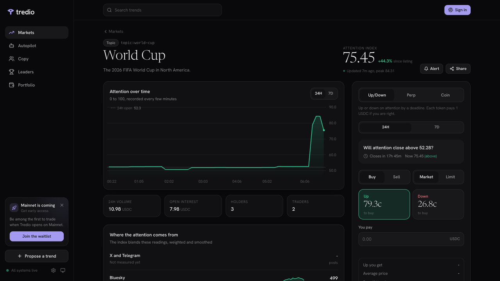
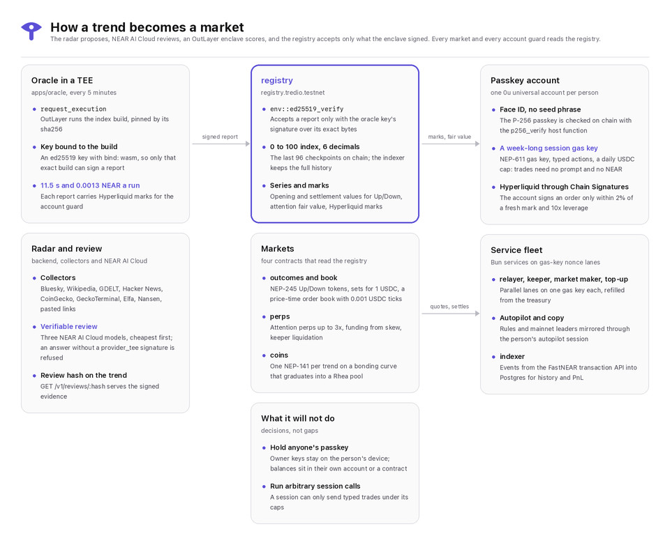
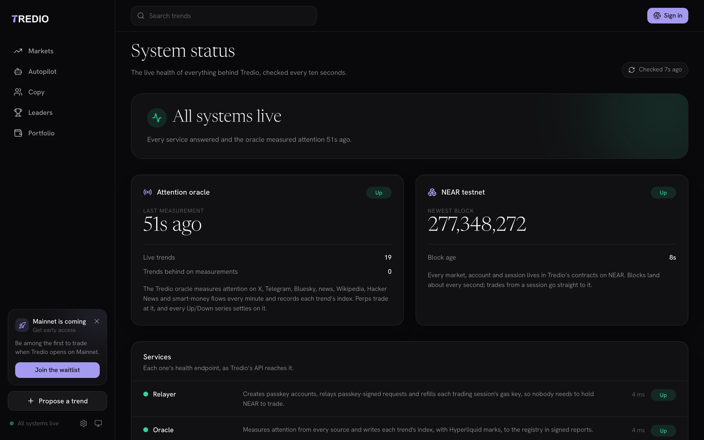
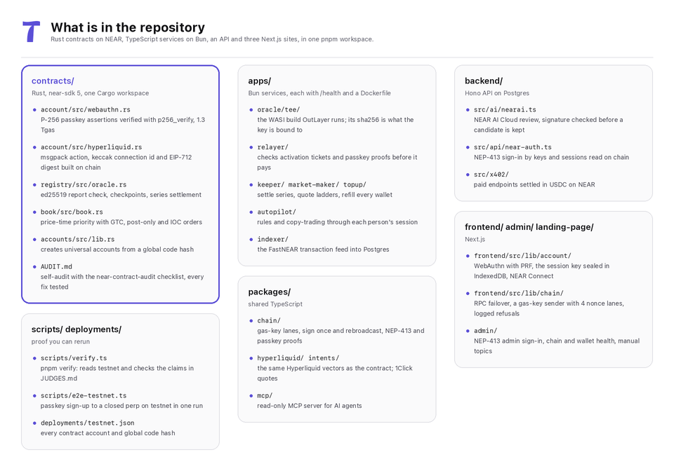
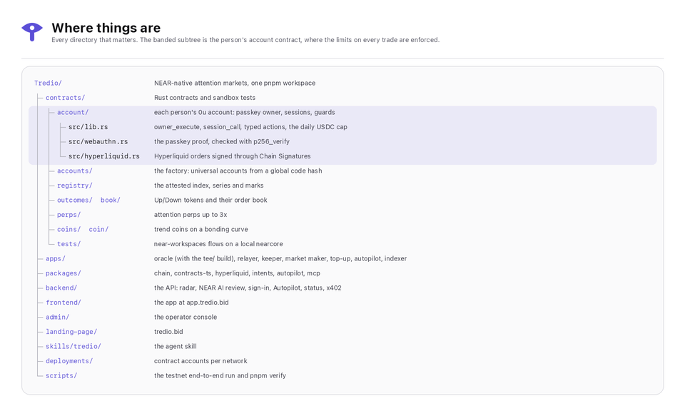

<picture>
  <source media="(prefers-color-scheme: dark)" srcset="assets/readme/hero-dark.png">
  <source media="(prefers-color-scheme: light)" srcset="assets/readme/hero-light.png">
  
</picture>

Tredio turns what the internet is talking about into markets you can trade.
An AI radar finds trends, NEAR AI Cloud reviews them with verifiable models, an oracle built to run in an OutLayer enclave scores each one from 0 to 100, and the score lives on NEAR, where people trade it.
You sign up with Face ID, get a NEAR account with no seed phrase, and trade for a week without another prompt or a drop of gas.

[App](https://app.tredio.bid) · [Website](https://tredio.bid) · [API status](https://api.tredio.bid/v1/status) · [Judges' guide](JUDGES.md) · [For AI agents](AGENTS.md) · [llms.txt](https://tredio.bid/llms.txt)

Everything runs on NEAR testnet: the contracts, the oracle, the accounts and every service.
The hosted app, website and API at tredio.bid go live before judging; until then everything runs locally against testnet (see [Run it](#run-it)), and every on-chain claim can be checked with `pnpm verify`.



## What you can trade

- **Up/Down series.** Will a trend's attention close above its opening level in 24 hours or 7 days?
  Each token pays 1 USDC if it is right, on an on-chain order book.
- **Attention perps.** Go long or short on the index itself, with isolated margin up to 3x and funding from the skew between longs and shorts.
- **Trend coins.** One token per trend on a bonding curve whose floor ratchets up with peak attention, graduating into a Rhea pool.
- **Hyperliquid perps** on the asset behind a trend, signed by your NEAR account.
- **Autopilot and copy-trading.** Rules with stop-loss, take-profit and loss limits, or follow a top Hyperliquid trader, executed through a session you can revoke.
- **Calls.** Post a public call from an unlinkable caller identity and build a hit rate on the leaderboard.

## Only on NEAR

Each of these is a NEAR primitive doing real work in the product, not a logo on a slide.

1. **Face ID accounts with no seed phrase and no gas.**
   A passkey creates a NEP-655 universal account (`0u...`) whose id is derived from the passkey itself, from inside the `accounts` factory, on a global contract.
   The account checks the passkey's P-256 signature on chain with the `p256_verify` host function, so no server can act as the owner.
   One prompt adds a week-long session key that is a NEP-611 gas key: it prepays its own gas and can only send typed trades under a daily USDC cap.
   In the app: Sign in, then trade.
   Code: [`contracts/account`](contracts/account), [`contracts/accounts`](contracts/accounts), [`frontend/src/lib/account`](frontend/src/lib/account).
2. **An oracle built for an enclave.**
   The attention index is computed by a WASI build made for [OutLayer](https://outlayer.ai)'s TEE, pinned by its sha256; OutLayer derives an ed25519 key bound to that exact build (`bind: wasm`).
   The `registry` contract accepts a report only with the signature of the one oracle key it trusts (`env::ed25519_verify`), checks its run id and time window, and clamps every move.
   Status on testnet: the build runs on OutLayer with an attested TDX quote, but the registry still trusts a bootstrap key the team holds, because the enclave reads the collectors' readings from the public API, which goes live with hosting; the switch is one public `set_oracle` transaction, and `pnpm verify` prints which key is in use.
   In the app: every trend page shows its index history; the status page shows the oracle's last run.
   Code: [`apps/oracle/tee`](apps/oracle/tee), [`contracts/registry/src/oracle.rs`](contracts/registry/src/oracle.rs), method and trust model in [`apps/oracle/docs`](apps/oracle/docs).
3. **AI review you can verify.**
   Every candidate the radar finds is reviewed by NEAR AI Cloud's verifiable models.
   An answer without a `provider_tee` signature is refused, and the hash of the signed evidence is written on the trend in the registry.
   The API serves the exact request and response the signature covers, so anyone can recompute both hashes and check the signature without trusting Tredio.
   Status on testnet: the API key is in place and the radar calls NEAR AI Cloud, but the account has no credits yet (it answers HTTP 402), so today's trends were added by hand and carry no review yet.
   In the app: the Verified chip on a reviewed trend opens the evidence.
   Code: [`backend/src/ai/nearai.ts`](backend/src/ai/nearai.ts), `GET /v1/reviews/:hash`.
4. **Hyperliquid perps from a NEAR account.**
   Your account contract builds the Hyperliquid order (msgpack action, connection id, EIP-712 digest) and asks [Chain Signatures](https://docs.near.org/chain-abstraction/chain-signatures) (`v1.signer-prod.testnet`) to sign it with your account's own derived key.
   A session can only sign orders within 2% of a fresh oracle mark and up to 10x leverage, enforced on chain.
   Status on testnet: accounts run account code v1, whose guard does not yet bind the mark to the signed asset; v2 fixes that ([AUDIT.md](contracts/AUDIT.md), H-1) and is published once the testnet treasury can pay for it.
   In the app: the Perp tab's Hyperliquid market, on a trend with an asset; today's live trends are topics, and crypto trends (NEAR and Hyperliquid are queued) list once Nansen confirms smart-money inflow.
   Code: [`contracts/account/src/hyperliquid.rs`](contracts/account/src/hyperliquid.rs), [`packages/hyperliquid`](packages/hyperliquid).
5. **Deposits from any chain.**
   Deposits and withdrawals go through [NEAR Intents 1Click](https://docs.near-intents.org), so USDC on another chain lands in your NEAR account in one step.
   1Click settles on mainnet only; on testnet the app shows real dry quotes.
   In the app: Deposit.
   Code: [`packages/intents`](packages/intents), [`backend/src/deposits`](backend/src/deposits).
6. **A service fleet on gas keys.**
   The relayer, keeper and market maker each send through a gas key with parallel nonce lanes, so one slow transaction never blocks the next; the top-up service refills those keys and every service wallet from the treasury.
   In the app: the status page lists every wallet, key and lane.
   Code: [`packages/chain`](packages/chain), [`apps`](apps).
7. **Autopilot on a revocable on-chain grant.**
   Turning on Autopilot adds a session labelled `autopilot` that can only trade Hyperliquid, under the same on-chain price and leverage guard, confirmed by reading the account.
   Stop-loss, take-profit and loss limits are enforced by the executor off chain.
   In the app: Autopilot.
   Code: [`apps/autopilot`](apps/autopilot), [`backend/src/autopilot`](backend/src/autopilot).
8. **Paid data for agents, settled in USDC on NEAR.**
   Premium API endpoints (full-resolution index history with every source reading, and Autopilot backtests) follow x402 v2's NEAR `exact` scheme: the API answers HTTP 402, the agent signs one USDC `ft_transfer` as a NEP-366 delegate action and sends it in `PAYMENT-SIGNATURE`, and Tredio's relayer submits it, so the agent needs no NEAR for gas.
   A read-only MCP server and an agent skill describe the whole product to AI agents; the MCP server can also buy the paid history under a spending cap.
   Code: [`backend/src/x402`](backend/src/x402), [`packages/chain/src/x402.ts`](packages/chain/src/x402.ts) (the paying client), [`packages/mcp`](packages/mcp), [`skills/tredio/SKILL.md`](skills/tredio/SKILL.md).

## How it works



The radar proposes trends from public sources and NEAR AI Cloud reviews each one.
The oracle runs every minute: it reports a trend when its index moves 1% or at least every seven minutes, and Hyperliquid marks on every run; the signed report updates the index, opens and settles series, and records the marks.
Markets read the registry: Up/Down series settle from it, perps use it as their price, coins ratchet their floor from its peak.
People trade from their own account contracts, and the services keep markets quoted, series settled and wallets funded.



## Contracts on testnet

| Contract | Account | What it does |
| --- | --- | --- |
| `registry` | [`registry.tredio.testnet`](https://testnet.nearblocks.io/address/registry.tredio.testnet) | Trends, the signed index, series opening and settlement values, Hyperliquid marks |
| `outcomes` | [`outcomes.tredio.testnet`](https://testnet.nearblocks.io/address/outcomes.tredio.testnet) | NEP-245 Up and Down tokens; a complete set mints and redeems for 1 USDC |
| `book` | [`book.tredio.testnet`](https://testnet.nearblocks.io/address/book.tredio.testnet) | Order book for Up and Down against USDC: limit, post-only and market orders |
| `perps` | [`perps.tredio.testnet`](https://testnet.nearblocks.io/address/perps.tredio.testnet) | Attention perps: isolated margin up to 3x, funding, liquidation |
| `coins` | [`coins.tredio.testnet`](https://testnet.nearblocks.io/address/coins.tredio.testnet) | One NEP-141 per trend on a bonding curve, graduating into Rhea |
| `curation` | [`curation.tredio.testnet`](https://testnet.nearblocks.io/address/curation.tredio.testnet) | Fee share for the account that first surfaced a trend |
| `accounts` | [`accounts.tredio.testnet`](https://testnet.nearblocks.io/address/accounts.tredio.testnet) | Factory for passkey universal accounts on a global contract |
| `usdc` | [`usdc.tredio.testnet`](https://testnet.nearblocks.io/address/usdc.tredio.testnet) | Test USDC with a faucet (mainnet uses native USDC) |

Account ids, global code hashes and the oracle key are in [`deployments/testnet.json`](deployments/testnet.json).
The contracts were self-audited against the near-contract-audit checklist and then reviewed independently; findings, fixes, what is still open on testnet and the team's remaining powers are in [`contracts/AUDIT.md`](contracts/AUDIT.md).

## Repository





## Run it

You need Node 22, Bun 1.3 or later, pnpm 10, Postgres 16, and Rust with `cargo-near` for the contracts.

```bash
pnpm install
pnpm dev
```

`pnpm dev` starts the API, the services and the app against the testnet contracts, and prints what each needs in its `.env` (every app has a `.env.example`).
Contracts build and test with `pnpm build:contracts` and `pnpm test:contracts`; the sandbox flows run with `cd contracts && cargo test -p tredio-sandbox-tests`.
The launch film is a Remotion project in [`video/`](video).

## Check it yourself

```bash
pnpm verify
```

`pnpm verify` reads NEAR testnet and checks the claims in [JUDGES.md](JUDGES.md): every contract holds code, user accounts run the factory's global code and derive from their passkeys, a live session gas key, the oracle key the registry trusts and how fresh its last report is, a Hyperliquid order signed through Chain Signatures, the OutLayer attestation of an enclave run, and an x402 payment; then it runs every test suite.

## For AI agents

- [AGENTS.md](AGENTS.md): how the repository is laid out and how to work in it.
- [`packages/mcp`](packages/mcp): a read-only MCP server for trends, markets, accounts and index verification.
- [`skills/tredio/SKILL.md`](skills/tredio/SKILL.md): a skill that teaches an agent to read and trade Tredio safely.
- [`llms.txt`](landing-page/public/llms.txt) and the x402 endpoints in the API.

## What came before the hackathon

The app's screens, the admin panel, the website and much of the backend come from an earlier Tredio prototype on another chain.
Everything on NEAR was built during the hackathon: the contracts, passkey accounts and sessions, the oracle and its enclave build, NEAR AI review, Chain Signatures, 1Click, the gas-key services, the indexer, the MCP server and the x402 API.
Demo trades on testnet were made by project-owned accounts, so activity you see there is not organic.

## License

[MIT](LICENSE)
